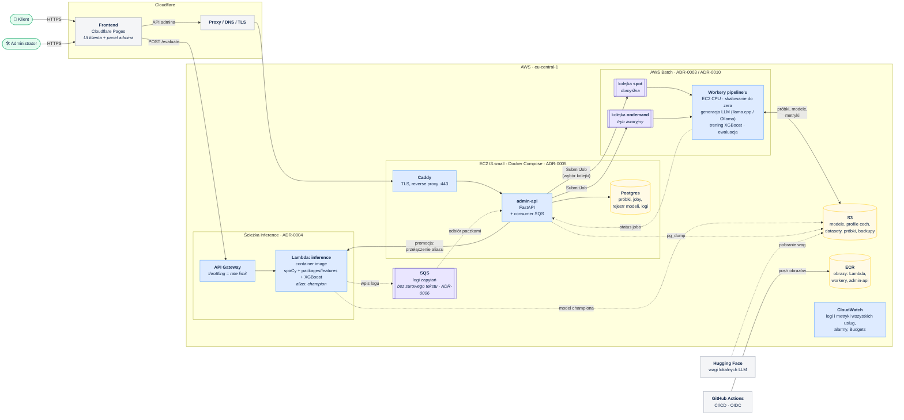

# Architektura systemu

Diagramy w [Mermaid](https://mermaid.js.org/) — źródło jest w tym pliku, GitHub renderuje je automatycznie. Wyrenderowane obrazy trafiają do lustra w Confluence (TAI-DETEKTOR → Architektura).

Poziomy według modelu [C4](https://c4model.com/):
1. Diagram kontekstu — _do zrobienia_
2. **Diagram kontenerów** — poniżej
3. Przepływy (sekwencje): ocena tekstu, retraining — _do zrobienia_

## Diagram kontenerów

Stan na 2026-10-31. Region AWS: eu-central-1 (ADR-0008).

**Legenda:** linia ciągła — wywołanie synchroniczne; przerywana — asynchroniczne / dostęp do artefaktów.

### Kluczowe granice
- **Inference jest odcięte od ciężkiej pracy.** Lambda nie dotyka Postgresa ani Batcha — tylko zwraca wynik i wrzuca log do SQS.
- **Publiczne API nie tworzy instancji.** admin-api jedynie zleca joby do kolejek Batch; cyklem życia instancji zarządza Batch.
- **Jedno źródło cech.** Lambda i workery używają tego samego `packages/features/` (ADR-0002).

## Luki, które ujawnił diagram (do decyzji)

1. **Uwierzytelnianie i role klient/admin** — wymagane przez `kontekst-projektu.md`, nieustalone. Kandydaci: Amazon Cognito vs własne JWT w admin-api. Dotyczy też tego, czy ocena tekstu wymaga logowania.
2. **Jak Lambda dostaje model championa.** ADR-0004 zakłada model „zapieczony w obrazie”, ale wtedy promocja wymaga zbudowania nowego obrazu — a workery Batch nie powinny budować obrazów. Kandydat: spaCy w obrazie, model XGBoost + profil cech pobierane z S3 w fazie init; wersja modelu jako zmienna środowiskowa **wersji** Lambdy, promocja = opublikowanie nowej wersji + przełączenie aliasu. Koszt: dłuższy cold start o pobranie małego pliku.
3. **Status jobów:** callback workerów do admin-api vs polling Batch / EventBridge. Wpływa na to, czy workery potrzebują dostępu sieciowego do EC2.
4. **Skąd workery biorą wagi LLM** — pobieranie z Hugging Face przy każdym jobie vs cache w S3 (kilka GB na model).
